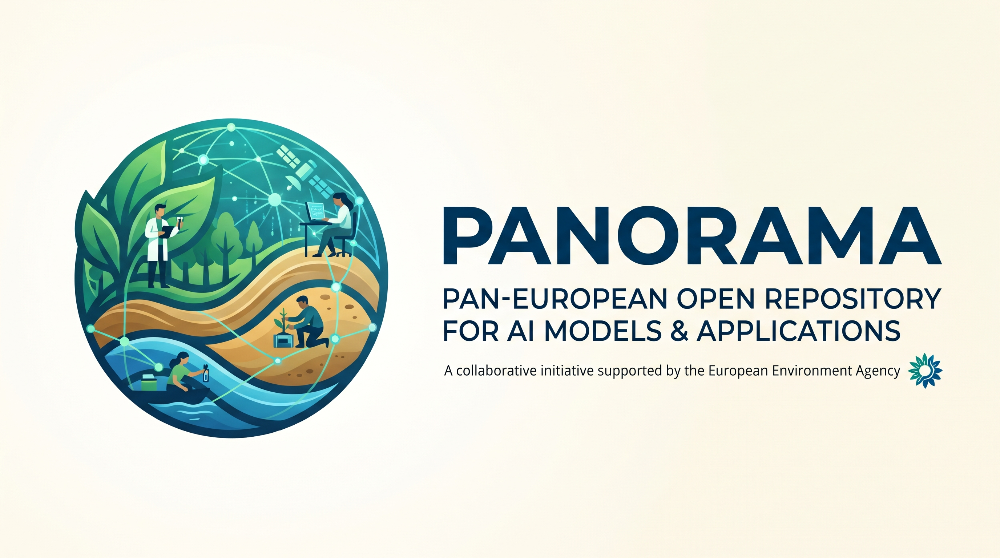

<p align="center">
  
</p>

# PANORAMA - an AI Project gallery

A static, template-driven gallery of project cards, published on GitHub Pages.

- One YAML file per project - no code changes needed to add one.
- Hover (or tab to) a card and it pops out of the page from its centre: bigger screenshot, full description, technologies, metadata and links to the website, repository, optional demo and docs.
- Top bar with search plus **Tags** and **Technologies** filters; status filter and sorting below it. Filters are reflected in the URL, so a filtered view can be shared.
- Works on phones (tap a card to expand it), in dark and light themes, and without any external requests (no CDN, no web fonts, no tracking).

```
projects/                 <- the real project cards live here (one .yaml per project)
  images/                 <- optional screenshots/thumbnails committed to the repo
resources/templates/      <- project-card.yaml: the commented template to copy
resources/examples/       <- a filled-in card (eagle-eye.yaml) plus fictional ones for previewing the layout
site/                     <- site.yaml (title, logo), Jinja2 template, CSS, JS
scripts/build.py          <- validates the cards and renders dist/
.github/workflows/        <- validate.yml (on PRs) and deploy.yml (on merge)
```

## Adding a project

1. Copy [`resources/templates/project-card.yaml`](resources/templates/project-card.yaml) to `projects/<short-name>.yaml` and fill it in. The template explains every field in plain language, and [`resources/examples/eagle-eye.yaml`](resources/examples/eagle-eye.yaml) shows a completed card.
2. *(Optional)* add images to `projects/images/` and reference them relatively, e.g. `screenshot_url: images/my-project.png`. Absolute `https://` URLs work too. Keep files under 1.5 MB; a landscape screenshot (about 1200 x 600 px) and a square thumbnail (about 128 x 128 px) look best. Without images the card shows a coloured placeholder with the project's initials.
3. Open a pull request. The **Validate project cards** check builds the site and annotates any problem directly on your file, in plain words.
4. When the PR is merged into `main`, the **Deploy gallery** workflow rebuilds the site and publishes it to GitHub Pages.

### No Git experience? Use the browser

You can do all of this on github.com without installing anything:

1. Open the [`resources/templates/project-card.yaml`](resources/templates/project-card.yaml) file and copy its contents (the copy button is at the top right of the file view).
2. Go to the `projects` folder, choose **Add file -> Create new file**, and name it e.g. `forest-watch.yaml`.
3. Paste the template, replace the example text with your own, and follow the notes in the file.
4. Click **Commit changes...**, choose **Create a new branch and start a pull request**, then **Propose changes** and **Create pull request**.
5. Wait a minute for the **Validate project cards** check. If it shows a red cross, open the details: it names the line to fix. Edit the file in the same pull request and the check runs again.

To add a picture the same way, open `projects/images`, choose **Add file -> Upload files**, and select **Commit directly to the branch** of your pull request.

### Card fields

| Field                                     | Required     | Notes                                                                       |
| ----------------------------------------- | ------------ | --------------------------------------------------------------------------- |
| `name`                                  | yes          | Card title                                                                  |
| `description`                           | yes          | Shown when the card is expanded. Blank lines start a new paragraph.         |
| `quip`                                  |              | One-line teaser shown on the collapsed card                                 |
| `website`, `repo_url`                 | at least one | Shown as **Website** and **Repository** buttons                 |
| `demo_url`, `docs_url`                |              | Optional **Demo** and **Docs** buttons                          |
| `screenshot_url`, `thumbnail_url`     |              | `https://...` URL or a path relative to `projects/`                     |
| `category`                              |              | Free text, shown in the details and searchable                              |
| `tags`                                  |              | List; feeds the **Tags** filter. Matching is case-insensitive.        |
| `stack`                                 |              | List; feeds the **Technologies** filter                               |
| `status`                                |              | `active` (default), `beta`, `maintenance` or `archived`             |
| `featured`                              |              | `true` shows a star and sorts the card first                              |
| `version`, `license`, `affiliation` |              | Shown in the details                                                        |
| `contact`                               |              | `Name <email>`; the name links to the email address                       |
| `released_on`, `updated_on`           |              | ISO dates (`YYYY-MM-DD`); drive the "Recently updated" / "Newest" sorting |

Files whose name starts with `_` are ignored, which is handy for drafts.

## Running locally

```bash
pip install -r requirements.txt
python scripts/build.py                  # projects/ -> dist/
python -m http.server -d dist 8000       # open http://localhost:8000
```

To try the layout with a fuller set of fictional cards:

```bash
python scripts/build.py --projects resources/examples --out preview
python -m http.server -d preview 8000
```

`python scripts/build.py --strict` is what CI runs: warnings (unknown fields, oversized images) fail the build too.

## Site settings

Title, logo emoji (also used as favicon), heading, tagline and search placeholder are in [`site/site.yaml`](site/site.yaml). The look is plain CSS in `site/static/style.css`; the page structure is `site/templates/index.html.j2`.

## One-time repository setup

1. Push this repository to GitHub.
2. **Settings -> Pages -> Build and deployment -> Source: GitHub Actions**.
3. Push to `main` (or run **Deploy gallery** manually). The site appears at `https://<owner>.github.io/<repo>/`.

All asset links are relative, so the site works under the `/<repo>/` sub-path as well as on a custom domain.

The build also writes `projects.json` next to `index.html`, a machine-readable copy of all cards.
