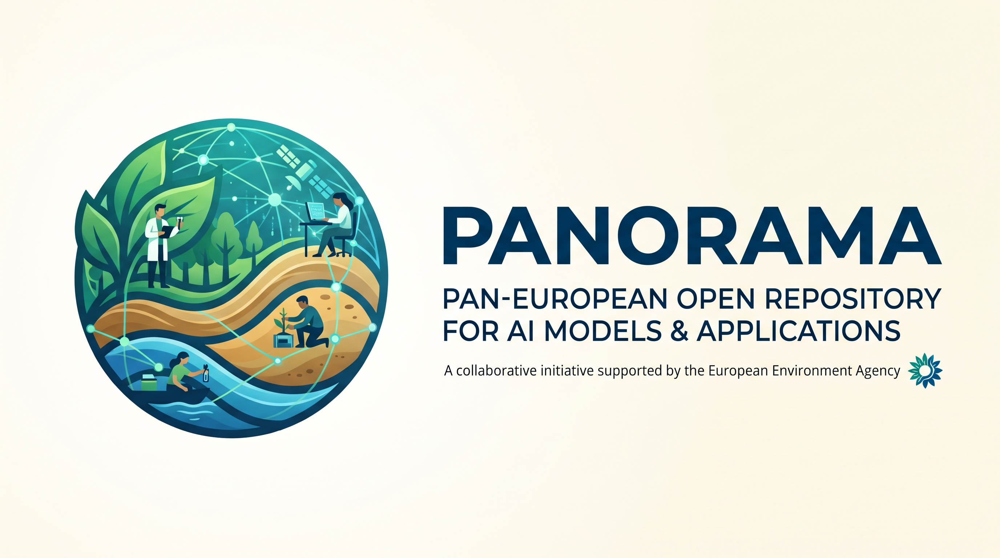

<p align="center">
  
</p>

# PANORAMA - an AI Project gallery

A static, template-driven gallery of **projects** and **use cases**, published on GitHub Pages.

- **Two kinds of cards**, one YAML file each, no code changes needed to add one:
  - a **project** is running or finished work and links to its own website, repository, demo and docs;
  - a **use case** is an idea - aspiring work that has not become a project yet. It gets a page of its own on the gallery site, an exposé with the full text, optional figures and the facts at a glance.
- Hover (or tab to) a card and it pops out of the page from its centre: bigger picture, summary, technologies, metadata and links.
- Top bar with search plus **Tags**, **Technologies**, **Area** and **Country** filters. A switch shows all cards, only projects or only use cases; projects can also be filtered by status. A country (or a tag or technology) shown on a card is clickable and filters the gallery by it. Filters are reflected in the URL, so a filtered view can be shared.
- Every card has an **Edit on GitHub** link, and cards can be updated or promoted from idea to project without editing files (see [Updating a card](#updating-a-card)).
- Use cases are **tagged automatically** from their text.
- Works on phones (tap a card to expand it), in dark and light themes, and without any external requests (no CDN, no web fonts, no tracking).

```
cards/                    <- every card lives below this root
  projects/               <- one .yaml per project (+ images/)
  use-cases/              <- one .yaml per use case (+ images/<card-name>/)
resources/templates/      <- project-card.yaml and use-case-card.yaml: the commented templates to copy
resources/examples/       <- filled-in and fictional cards for previewing the layout
site/                     <- site.yaml (title, logo), taxonomy.yaml (automatic tags), Jinja2 templates, CSS, JS
scripts/build.py          <- validates the cards and renders dist/
scripts/import_use_case.py<- turns a submitted Word document into a draft use-case card
.github/workflows/        <- validate.yml (on PRs) and deploy.yml (on merge)
```

## Adding a card

Both kinds follow the same four steps; use the template that matches your card:

| I want to add...                                   | Template                                                                        | Folder             |
| -------------------------------------------------- | ------------------------------------------------------------------------------- | ------------------ |
| a **project** (running or finished work)           | [`resources/templates/project-card.yaml`](resources/templates/project-card.yaml)   | `cards/projects/`  |
| a **use case** (an idea that is not a project yet) | [`resources/templates/use-case-card.yaml`](resources/templates/use-case-card.yaml) | `cards/use-cases/` |

1. Copy the template to `cards/<folder>/<short-name>.yaml` and fill it in. The templates explain every field in plain language; [`resources/examples/projects/eagle-eye.yaml`](resources/examples/projects/eagle-eye.yaml) and [`resources/examples/use-cases/quality-control-example.yaml`](resources/examples/use-cases/quality-control-example.yaml) show completed cards.
2. *(Optional)* add images next to the card (see below).
3. Open a pull request. The **Validate cards** check builds the site and annotates any problem directly on your file, in plain words.
4. When the PR is merged into `main`, the **Deploy gallery** workflow rebuilds the site and publishes it to GitHub Pages.

### Images

Add images to the `images` folder of the card type and reference them relatively. Absolute `https://` URLs work too. Keep each file under 1.5 MB. Without images a card shows a coloured placeholder.

- **Project:** `screenshot_url: images/my-project/screenshot.png` (landscape, about 1200 x 600 px) and `thumbnail_url: images/my-project/logo.png` (square, about 128 x 128 px), files in `cards/projects/images/my-project/`.
- **Use case:** a list of figures with optional captions, files in `cards/use-cases/images/<card-name>/`. They appear on the use case's page; the first one is also shown on its gallery card.

```yaml
images:
  - file: images/my-idea/architecture.png
    caption: How the pieces fit together
```

Only publish pictures you are allowed to: no personal data (names, e-mail addresses, screenshots of internal tools showing real people) and nothing copyrighted by others.

### No Git experience? Use the browser

You can do all of this on github.com without installing anything:

1. Open the template that matches your card and copy its contents (the copy button is at the top right of the file view).
2. Go to the `cards/projects` or `cards/use-cases` folder, choose **Add file -> Create new file**, and name it e.g. `forest-watch.yaml`.
3. Paste the template, replace the example text with your own, and follow the notes in the file.
4. Click **Commit changes...**, choose **Create a new branch and start a pull request**, then **Propose changes** and **Create pull request**.
5. Wait a minute for the **Validate cards** check. If it shows a red cross, open the details: it names the line to fix. Edit the file in the same pull request and the check runs again.

To add a picture the same way, open the card type's `images` folder, choose **Add file -> Upload files**, and select **Commit directly to the branch** of your pull request.

### Use cases submitted as Word documents

Use cases are collected with a Word template. The Word documents themselves are **not** stored in this repository: they can contain personal data, and the card is the published record. The use-case card has exactly the sections of the Word template, so a submitted document can be converted almost mechanically:

```bash
python scripts/import_use_case.py "path/to/My idea.docx"
```

The script reads the seven numbered sections, detects the ticked main area (whichever kind of check box was used), converts bullet lists, removes left-over template hints and writes `cards/use-cases/my-idea.yaml`. Figures embedded in the document are extracted next to it, with their "Pic. 1: ..." captions.

The result is a **draft**. Before committing, read it through and:

- add a one-line `quip` (and a `summary` if the first sentences of `proposed_ai` do not make a good teaser);
- fill in `affiliation` and `country`;
- **check every extracted figure** for personal data (e.g. screenshots showing real names) and for third-party copyright (e.g. charts from other organisations), and delete the ones that cannot be published.

Tags need no attention; they are added automatically (next section). Keep the original document outside the repository (the card header names the file it was converted from). `python scripts/check_importer.py` is a self-test of the converter; CI runs it.

### Automatic tags

When the site is built, each use case is scanned for the keywords listed in [`site/taxonomy.yaml`](site/taxonomy.yaml). A topic that shows up often enough becomes a **tag** (for example "Water and hydrology"), a tool or method becomes a **technology** (for example "MCP"). The file is plain YAML with its own explanation at the top; adjust the vocabulary there, without touching any code. Tags written into a card by hand are kept and shown first; `auto_tag: false` switches the automation off for one card. Projects are not tagged automatically - their authors choose their tags.

### Password protection

The published site is **encrypted**: every page and image is stored encrypted (AES-256-GCM) on GitHub Pages, and visitors see only a password prompt. After the right password is entered, the browser decrypts the pages locally; nothing is sent anywhere. Once unlocked, moving between pages in the same browser tab does not ask again. Closing the tab forgets the unlock.

- **Set the password once:** repository **Settings -> Secrets and variables -> Actions -> New repository secret**, name `GALLERY_PASSWORD`. The **Deploy gallery** workflow reads it, encrypts the site, and *refuses to publish* if the secret is missing. To change the password, change the secret and re-run the workflow (old links keep working with the new password).
- **Local preview:** a plain `python scripts/build.py` builds an unprotected site for your own computer. To try the protected one, set the variable first (PowerShell: `$env:GALLERY_PASSWORD = "test"`; bash: `GALLERY_PASSWORD=test python ...`) and open the result through `python -m http.server`.
- **Checked automatically:** `scripts/check_protected.py` fails the pull request check if a protected build would contain readable card text, readable images or `projects.json` (which is therefore not published for a protected site).

What this does **not** do - please read before relying on it:

- It protects the *published website*, not the *repository*. Cards and their images are readable by everyone who can read the repository. If the repository is public, so is everything in it; keep it private (or keep personal data out of it) if names must stay confidential.
- Anyone who has the password can read everything and share it; there is no per-person login and no way to revoke one person. Rotate the password to lock everybody out.
- The encrypted files can be downloaded by anyone and attacked offline. The key is stretched (PBKDF2, 600,000 rounds), so a **long passphrase** (for example four or five random words) is strong; a short or common password is not.
- File names, page addresses (`use-cases/<card-name>/`), the number of cards and the size of images stay visible. Search engines are asked not to index the site.

### Card fields

**Project** (`cards/projects/`)

| Field                               | Required     | Notes                                                                     |
| ----------------------------------- | ------------ | ------------------------------------------------------------------------- |
| `name`                              | yes          | Card title                                                                |
| `description`                       | yes          | Shown when the card is expanded. Blank lines start a new paragraph.       |
| `quip`                              |              | One-line teaser shown on the collapsed card                               |
| `website`, `repo_url`               | at least one | Shown as **Website** and **Repository** buttons                           |
| `demo_url`, `docs_url`              |              | Optional **Demo** and **Docs** buttons                                    |
| `screenshot_url`, `thumbnail_url`   |              | `https://...` URL or a path relative to `cards/projects/`                 |
| `category`                          |              | Free text, shown in the details and searchable                            |
| `tags`                              |              | List; feeds the **Tags** filter. Matching is case-insensitive.            |
| `stack`                             |              | List; feeds the **Technologies** filter                                   |
| `status`                            |              | `active` (default), `beta`, `maintenance` or `archived`                   |
| `featured`                          |              | `true` shows a star and sorts the card first                              |
| `version`, `license`, `affiliation` |              | Shown in the details                                                      |
| `country`                           |              | One country, or several separated by commas; feeds the **Country** filter |
| `contact`                           |              | `Name <email>`; the name links to the email address                       |
| `released_on`, `updated_on`         |              | ISO dates (`YYYY-MM-DD`); drive the "Recently updated" / "Newest" sorting |

**Use case** (`cards/use-cases/`) - the text sections correspond to the numbered sections of the Word template. Every text field takes plain text (blank line = new paragraph, lines starting with `- ` = bullet points) or a YAML list of bullet points.

| Field                                                | Required | Word template section                  |
| ---------------------------------------------------- | -------- | -------------------------------------- |
| `name`                                               | yes      | title                                  |
| `main_area`                                          | yes      | 1. Main area (one of the four areas)   |
| `challenge`                                          | yes      | 2. Challenge or opportunity            |
| `proposed_ai`                                        | yes      | 3. Proposed use of AI                  |
| `scope`                                              |          | 4. Scope                               |
| `expected_outcome`                                   |          | 5. Expected outcome                    |
| `environmental_contribution`, `digital_contribution` |          | 6. Contribution (or one `contribution`) |
| `conditions`                                         |          | 7. Key conditions and considerations   |
| `quip`, `summary`                                    |          | one line and two sentences for the card |
| `affiliation`, `country`, `contact`                  |          | who and where                          |
| `images`                                             |          | figures, each with a `file` and an optional `caption` |
| `tags`, `stack`, `auto_tag`                          |          | additions to / switch for the automatic tags |
| `submitted_on`                                       |          | ISO date; used for sorting             |

Files whose name starts with `_` are ignored, which is handy for drafts.

## Updating a card

Cards change: a project gets a new version, a use case gets a partner, an idea becomes a project. Every card is one file, so updating it works like adding it: through a pull request that is checked automatically. This is the same for **projects and use cases**.

| I want to ...                                                      | How                                                                                                                                                                                                                                 |
| ------------------------------------------------------------------ | ----------------------------------------------------------------------------------------------------------------------------------------------------------------------------------------------------------------------------------- |
| change anything on a card (text, tags, links, pictures ...)        | Point at the card in the gallery (or open the use case's page) and click **Edit on GitHub**. Change the file and choose *Create a new branch and start a pull request*. To replace a picture, upload the new file to the card type's `images` folder. |
| change a few one-line fields (status, version, links, country ...) | **Actions -> Update a card -> Run workflow.** Choose the kind and name of the card and fill in only what changed. A project's `updated_on` is set to today.                                                                           |
| turn a use case into a project                                     | **Actions -> Promote use case to project -> Run workflow.** Give the use case's name, the project's website and/or repository, and the status.                                                                                          |
| remove a card                                                      | Delete its file (and its images) in a pull request. The address of a removed use case's page stops working.                                                                                                                        |

Both workflows check the result with the normal site build and push it to a **new branch** (never to `main`). The run's summary page then links to GitHub's pull-request form; the *Validate cards* check runs on that pull request, and merging it updates the site.

**Promoting** moves `cards/use-cases/<name>.yaml` to `cards/projects/` together with its images. The project description is built from the use case's summary and the start of its "proposed use of AI"; the status defaults to `beta`. Projects are not tagged automatically, so the tags and technologies the use case had are written into the card. The use case's long sections (challenge, scope, conditions ...) have no place on a project card; they stay in the repository history. Please read the new card in the pull request and adjust the description. Going from project back to use case is not automated.

The same tools run on a computer, for batches or when you prefer a terminal:

```bash
python scripts/update_card.py project my-project status=active version=1.2.0
python scripts/update_card.py use-case my-idea country=Italy
python scripts/promote_card.py my-idea --website https://example.org/my-idea --status beta
```

Notes:

- *Edit on GitHub* links need to know the repository: GitHub Actions provides it; for a local preview set `repository: owner/name` in [`site/site.yaml`](site/site.yaml).
- The workflows ask for write access to the repository's contents in their own definition. If your organisation forbids that for Actions, they fail with a permissions message and the command-line tools are the fallback.
- To update a use case that arrived as a *new version of a Word document*, edit the card rather than importing again: `import_use_case.py --force` would overwrite the hand-written `quip`, `summary`, organisation and country.
- Renaming a card means renaming its file; the address of a use case's page changes with it.

## Running locally

```bash
pip install -r requirements.txt
python scripts/build.py                  # cards/ -> dist/
python -m http.server -d dist 8000       # open http://localhost:8000
```

To try the layout with the example cards:

```bash
python scripts/build.py --cards resources/examples --out preview
python -m http.server -d preview 8000
```

`python scripts/build.py --strict` is what CI runs: warnings (unknown fields, oversized images) fail the build too.

## Site settings

Title (also the browser tab title) and the tooltip that spells it out, logo emoji (also used as favicon), heading, tagline, search placeholder and the GitHub repository are in [`site/site.yaml`](site/site.yaml). The look is plain CSS in `site/static/style.css`; the page structure is in `site/templates/` (`index.html.j2` for the gallery, `use-case.html.j2` for a use case's page).

## One-time repository setup

1. Push this repository to GitHub.
2. **Settings -> Pages -> Build and deployment -> Source: GitHub Actions**.
3. **Settings -> Secrets and variables -> Actions -> New repository secret:** `GALLERY_PASSWORD` (see [Password protection](#password-protection)).
4. Push to `main` (or run **Deploy gallery** manually). The site appears at `https://<owner>.github.io/<repo>/`.

All asset links are relative, so the site works under the `/<repo>/` sub-path as well as on a custom domain.

An unprotected local build also writes `projects.json` next to `index.html`, a machine-readable copy of all cards (projects and use cases, including the automatic tags). It is left out of protected builds.
